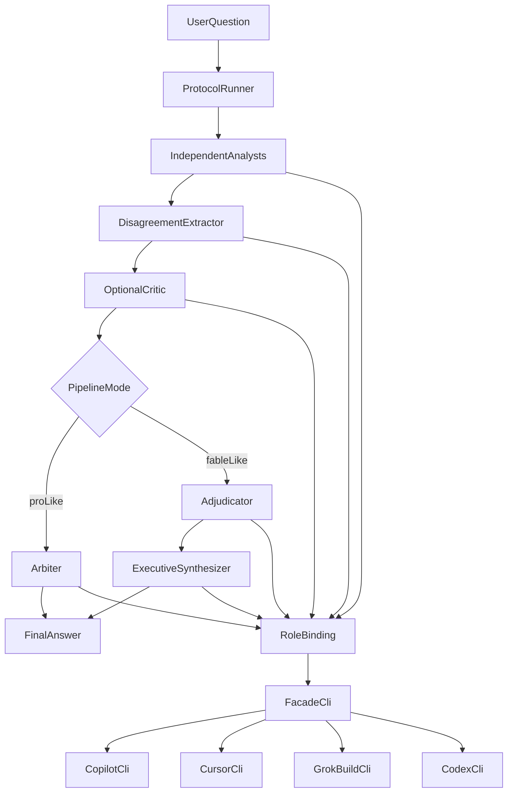

# Pro-like 推論の構成

## 結論

推論の段取りは、このリポジトリの小さな C# 実行役がコードで持つ。各役割の1回の実行は、[codex_agent_facade](D:/Data/git/codex_agent_facade) の通常アプリ向け CLI へ渡す。OpenClaw（[openclaw-personal-agent](D:/Data/git/openclaw-personal-agent)）は、その実行役を後から呼ぶチャット入口にする。

最初の実行先は、main にマージ済みの `CodexAgentFacadeCli` である。1回の起動で `github-copilot`、`cursor`、`grok-build`、`codex` のいずれかを実行する。Copilot SDK の直呼びは最初の実装に含めない。契約の正本は [docs/cli.md](https://github.com/suusanex/codex_agent_facade/blob/main/docs/cli.md) とする。

## なぜこの分割か

[#1](https://github.com/suusanex/ai-agent-gpt-pro-like-chat/issues/1) の価値は、最初の分析で互いの回答を見せないことである。この分離はプロンプトのお願いではなく、呼び出し側が別セッションを作り、相手の回答を渡さないことで保証する。

[#2](https://github.com/suusanex/ai-agent-gpt-pro-like-chat/issues/2) の価値は、その材料を「何を信じるか」と「信じた材料から何が言えるか」の2段で畳むことである。段の境目は、前段の成果物ファイルを次段の入力にすることで残す。

既存資産の役割は次のとおり。

- [codex_agent_facade](D:/Data/git/codex_agent_facade) は Copilot CLI、Grok Build CLI、Cursor CLI、Codex CLI への薄い実行輸送である。planner ではない。本件の最初の実行先は、main に入っている `CodexAgentFacadeCli` である。
- [MultiCodingAgentFacade](D:/Data/git/multi_coding_agent_facade) は Copilot SDK と Codex App Server の型付きクライアントである。最初の実行経路には使わない。SDK session や Codex App Server が必要になった段階の呼び出し実装として残す。
- OpenClaw の現行 MVP は `chat-grok` と `script-worker` の Gateway である。永続チャット、ツール許可、承認付きコマンドが本務で、再現可能な段取り実験の実行面ではない。ここに analyst を置くと、session 履歴、memory、サブエージェント協調が分離保証とぶつかる。
- Microsoft Agent Framework は今回の段取りに対して実行基盤が大きすぎる。段の順序、失敗時停止、成果物の保存は通常の C# で足りる。

契約が変わってもプロトコル本体は変えない。変わるのは「どの harness の、どの model で、その役割を1回実行するか」だけである。自動ルーティングと、失敗した役割の別モデルへのフォールバックは作らない。失敗はその役割のエラーとして実行全体を止める。

## 公開済み Facade CLI

通常アプリ向け CLI は main にマージ済みである。入口は publish した `CodexAgentFacadeCli.exe` で、開発時は `dotnet run --file src/CodexAgentFacadeCli.cs` である。常駐 MCP ホストとは別プロセスで、`CODEX_AGENT_FACADE_TOKEN` は不要である。引数は受け取らない。標準入力へ snake_case の JSON を1個書き、stdin を閉じ、標準出力の JSON を1個読む。

実行役が渡すフィールドは次のとおり。

- 必須: `agent`、`prompt`、`working_directory`
- 任意: `model`、`reasoning_effort`、`fast`、`timeout_seconds`、`auto_approve`、`skills`
- 渡さない: `session_id`、`request_id`。`request_id` は未知フィールドとして拒否される。CLI は job 保存も二重起動防止も持たない

`agent` は `github-copilot`、`cursor`、`grok-build`、`codex` である。省略した `session_id` は新しい外部 session になる。並列の役割は別プロセスで起動し、同じ `session_id` を共有しない。

成功は終了コード 0 かつ `status=completed` で、`result.outputText`、`result.sessionId`、`result.outputKind`、`result.runId` を役割の結果として残す。`outputKind` が `assistant_transcript` でも、その本文を捨てて別 agent へは切り替えない。終了コード 1、2、4、または `status` が `failed` / `timed_out` のときは、その役割の失敗として実行全体を止める。`failure.kind` と `failure.summary` をトレースログへ残す。

`fast` は設定に書かれた値をそのまま送る。実行役は agent ごとの可否を持たない。Facade が起動前に拒否したときは、その役割の失敗として実行を止める。初回の Copilot 設定には `fast` を書かない。

段取り本体は Facade の外に置く。独立 analyst の起動、相手の回答を渡さないこと、disagreement、critic を起動する条件、`pro-like` と `fable-like` の分岐、run 成果物の保存は、このリポジトリの実行役が持つ。

Facade の Copilot Driver は `copilot` CLI であり、GitHub Copilot SDK ではない。Issue #1 の当初文は最初の実験基盤を SDK session としていた。今回の設計では、その最初の実行先を Facade CLI の独立プロセスへ変更する。File-based App から Facade の C# を直接参照する再利用にはしない。

## 実行の形

役割バインディングは1回の入出力だけを持つ。

- 入力: その役割専用のプロンプトと、その段に渡してよい成果物だけ
- 出力: 最終テキスト、harness 名、model 名、session 識別子、診断情報
- 共有しないもの: 他役割の transcript、前の質問の memory、ツールによるファイル変更

analyst は同じ質問を並列の別プロセスで処理する。人数、agent、model は設定値にし、コードに固定しない。初回の実験設定は `github-copilot` の3本に固定する。model は3本とも設定に書く。Cursor、Grok、Codex を混ぜる比較は、その有効性を見たあとの設定変更であり、初回設定には入れない。各呼び出しは、このリポジトリの外に作る、その呼び出し専用の空 directory を `working_directory` にする。出力先の末尾名が同じ別 run や、前回の後段再実行とは作業場所を共有しない。過去の作業 directory は残し、次の呼び出しの入力にはしない。`skills` と `session_id` は渡さない。コーディング CLI がその directory を変更した場合は成果物として残す。実験設定では `model`、`timeout_seconds`、`auto_approve` を必ず書く。

並列 analyst の1本が失敗したときは、残りの Facade CLI プロセスを直ちに Kill し、disagreement 以降を始めない。Kill されたプロセスは標準出力の JSON を出さないことがある。これは [docs/cli.md](https://github.com/suusanex/codex_agent_facade/blob/main/docs/cli.md) の強制終了時の契約である。実行役は、最初の失敗の JSON または終了コード、Kill したプロセス、JSON が無いことは強制終了の結果であること、をトレースログへ残す。Kill した側の完了は待たない。analyst より後の段は1本ずつ実行する。

disagreement の出力は見出し付きテキストとし、末尾の非空行を次のどちらか1行にする。

- `DISAGREEMENT: present`
- `DISAGREEMENT: none`

この行が無い、またはこの2つ以外のときは、実行を失敗させる。本文の解釈で一致を推定しない。`present` のときだけ critic を起動する。`none` のときは critic を起動しない。

比較実行は、同じ前段から両方の後段を作る。

- 共有する前段: analyst、disagreement、条件を満たした critic
- `pro-like` 後段: arbiter が `final-pro-like` を書く
- `fable-like` 後段: adjudicator が裁定を書き、executive synthesizer が `final-fable-like` を書く
- 保存済み run directory から、前段を再実行せず後段だけを再実行できる。対象は `pro-like`、`fable-like`、または両方
- `baseline` は同じ agent、model、timeout、`auto_approve` での1回呼び出しであり、前段は共有しない

adjudicator の出力は、最終回答の文章にしない。最初の実験では固定 JSON schema を先に固めず、見出し付きの明示成果物にする。項目は、判断を左右する論点、採用、棄却または保留、不一致の種類、残る不確実性。

各実行は run ディレクトリへ成果物を残す。質問、各 analyst 出力、disagreement、critic の有無、両方の後段、使った agent と model。#1 の成功は大外しの減少、#2 の成功は同じ前段に対して `final-fable-like` が `final-pro-like` より決め手と行動を読み取れること、として人間が並べて見る。自動採点はこの設計の範囲外とする。

## 役割へ渡す入力

役割プロンプトはリポジトリ内の Markdown とし、実行役が読んで、その段の成果物と連結してセッションへ渡す。OpenClaw の SKILL や、モデル自身の「他を見るな」という指示には分離を任せない。

- analyst: 役割プロンプトと元質問。他 analyst の出力は含めない
- disagreement: 役割プロンプト、元質問、全 analyst 出力
- critic: 役割プロンプト、元質問、disagreement 成果物。analyst 原文は含めない
- arbiter: 役割プロンプト、元質問、全 analyst 出力、disagreement 成果物、critic を起動した場合はその成果物
- adjudicator: arbiter と同じ入力。出力は裁定成果物とする
- executive synthesizer: 役割プロンプト、元質問、裁定成果物。既定では analyst 原文を含めない。原文も渡す比較は設定で選ぶ
- baseline: 役割プロンプトを付けず、元質問だけを渡す

## 設定の形

役割ごとに次を書く。認証情報そのものは置かず、各 CLI の既存ログインを使う。実行ファイルのパスは設定で与え、token は request に書かない。

- `agent`: `github-copilot`、`cursor`、`grok-build`、`codex`。初回設定は `github-copilot` だけ
- `model`: 実験設定では必須。実行役は省略時の既定モデルに任せない
- `reasoning_effort`: 未指定なら送らない
- `fast`: 設定にあるときだけ送る。agent ごとの除外はしない
- `timeout_seconds`: 実験設定では必須
- `auto_approve`: 実験設定では必須。初回は `false` とし、Facade が Copilot へ `--allow-all` を付けない状態で比較する

`auto_approve=false` はツール不使用の証明ではない。Copilot 公式 CLI はプログラム実行に `--allow-all-tools` を必要と書いており、Facade の 2026-08-23 観測では `false` でも承認待ちにならずに終了している。初回実行は、run log に残った起動引数と、空の working directory への変更有無を記録する。`false` でテキスト回答が得られない場合は、その失敗で停止する。

Copilot CLI には `--no-custom-instructions` があり、`AGENTS.md` と `$HOME/.copilot/copilot-instructions.md` などの読み込みを止める。Facade の JSON 契約にこのフラグは無く、未知フィールドは拒否される。`GitHubCopilotDriver.BuildArguments` もこの引数を付けない。初回実装では Facade を変更しない。working directory をリポジトリ外の空 directory にすることで、このリポジトリの `AGENTS.md` を親 directory 探索で読ませない。ユーザー全体の custom instructions は残る混入として、実験記録に書く。

Copilot SDK は、CLI プロセスでは足りない session 性質が実験で必要になった段階の別 harness として残す。

## OpenClaw の置き場所

プロトコルの比較が手元で回ったあと、OpenClaw の `script-worker` に登録済み command を1つ足す。その command は実行役を1回呼び、最終回答だけをチャットへ返す。analyst ごとの agent、Gateway 内の subagent 協調、共有 memory は作らない。

これにより、普段の入口は OpenClaw のままで、契約の差し替えは実行役の設定に残る。

## 決定の記録

Issue #1 の当初決定は、最初の実験基盤を GitHub Copilot SDK の独立 session とすることだった。このプランでは、その実行先を main の `CodexAgentFacadeCli` による独立プロセスへ変更している。分離の保証は、別プロセス、`session_id` を渡さないこと、相手の回答を前段プロンプトへ入れないこと、に置く。

この変更はプランファイルだけでは Issue の決定履歴に残らない。実装の前に、同じ内容を [issue #1](https://github.com/suusanex/ai-agent-gpt-pro-like-chat/issues/1) へコメントし、このプランをリポジトリの `plans/` に commit する。

## 最初の実装境界

Facade CLI は完成済みなので、次に作るものはこのリポジトリの File-based App である。中身は実行役、3つのパイプラインモード、`CodexAgentFacadeCli.exe` を呼ぶ役割バインディング、成果物の保存とする。`.csproj` は作らない。段取り、analyst の分割、裁定、最終文章生成は Facade へ足さない。Copilot SDK と OpenClaw command は最初の実行に含めない。

失敗時は例外を握りつぶさず、`Exception.ToString()` をトレースログへ出して実行を止める。
